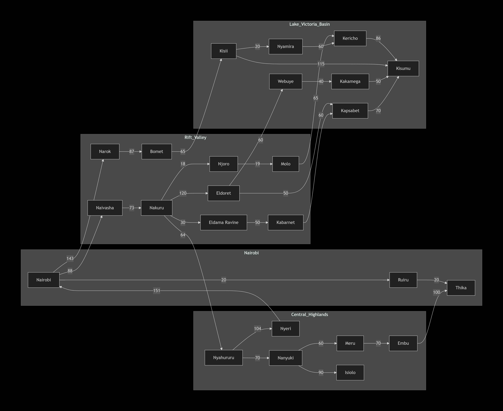
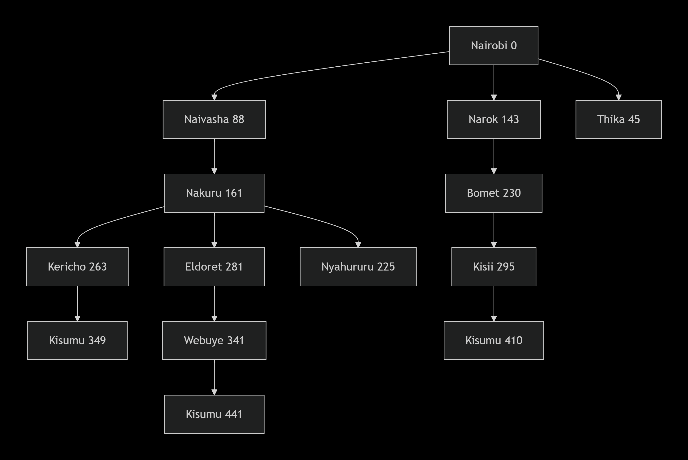

## Practical Exercise 3: Designing a Searching Agent

### QUESTION 1 
Design the agent using the PEAS framework and further define its environment using the 5 definitions of agent environments
#### PEAS Framework 
1. **Perfomance measure** - minimizing travel distance and time, avoiding accidents, reaching the destination safely and complying with traffic rules.
2. **Environment** -  Kenyan towns, roads, highways, other vehicles and obstacles 
3. **Actuators** - brakes, accelarator , steering wheel, headlights and horn. 
4. **Sensors** - Cameras, GPS, LiDAR, speed sensors and fuel sensors. 

#### The Agent Environment Using the 5 Properties
1. Fully Observable vs Partially Observable
**Partialy observable** 
The agent cannot get all the information even with all those sensers since they can be obstracted by many thing including cars and other weather conditions. 
2. Deterministic vs Stochastic
**Stochastic**. 
The road is not always predictable due to Drivers and pedestrians and therefore the action of the agent can not be predetermined. 
3. Episodic vs Sequential
**Sequential**. 
Each action affects the next action eg. Changing lanes, what route to use, speed, etc 
4. Static vs Dynamic
**Dynamic** 
The environment changes while the agent is at work. Vehicles change lanes, Traffic lights change andpedestrians cross the road. 
5. Discrete vs Continuous
**Continuous**
The environment has varibles such as speed, steering angle, distance, time, and vehicle position can change continuously.

### QUESTION 2
Develop a suitable directed graph and search tree based on the map presented in class of Kenya’s Highway Network featuring cities and towns in the Nairobi, Central Highlands, Rift Valley and Lake Victoria Basin regions. For reference, you can use this Google Maps view to generate the graph and tree. The tree should apply the concept of abstraction as discussed in class. 
#### Directed Graph 

#### Tree

### QUESTION 3 
Using distance between towns as the path cost function, determine the optimal path the trailer can take from Nairobi to Kisumu. Calculate the distance between towns using this Google Maps search feature.

#### Answer 
That I was able to calculate using the tree that I built the optimal path is Nairobi → Naivasha → Nakuru → Kericho → Kisumu 
88+73+102+86= 349km
So the full optimal path cost is approximately 349 km.

### Group Members
1. 189719 - Caleb Munene - Question 2
2. 184066 - Dalton Mule - Question 1
3. 176830 - Wachira Ivan -Question 3

With a group discussion to go through all the work together done over Google meet 
